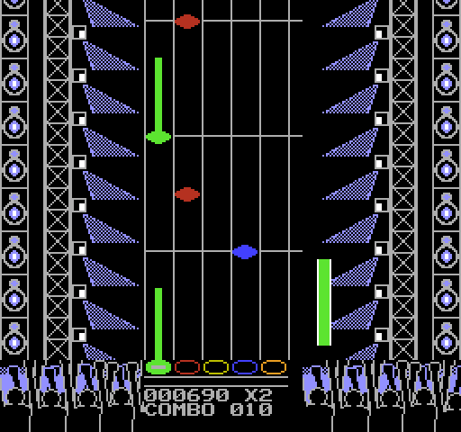
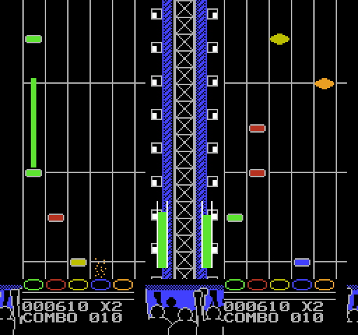

# NESBand

Un juego de ritmo estilo Guitar Hero / Rock Band para el NES, con canciones de otros juegos de NES.

**Estado actual:** título, menú (canción, jugadores, instrumento y dificultad), juego para **1 o 2
jugadores** con pausa, y pantalla de resultados con precisión, combo máximo y estrellas. Cartucho MMC3
de 512 KB con espacio para 31 canciones. Los charts se generan automáticamente para guitarra, teclado y
bajo en 4 dificultades, y los aciertos y fallos están sincronizados al cuadro con la música. Si fallas,
tu instrumento se calla hasta tu siguiente acierto, como en Rock Band.

**Canciones:** el repositorio trae diez, originales de NESBand (GPL-2.0-or-later), cada una con un
instrumento distinto al frente: *Primer Ensayo* (`audio/demo.txt`), *Tormenta de Neon* (rock, guitarra),
*Luz de Luna* (balada, teclado), *Salto Mortal* (funk, bajo), *Marcha del Cartucho* (marcha chiptune),
*Noche sin Estrellas* (oscura, arpegios rápidos), *Carrera de Fuego* (rock de arcade a 180 BPM con bombo y
tarola en samples DPCM, guitarra y órgano en duelo) y *Brisa de Verano* (surf, notas picadas muy rápidas
sobre un bajo que camina), *Cumbia del Cartucho* (cumbia a 100 BPM, el acordeón sobre un bajo de tumbao)
y *Amanecer Digital* (himno de trance a 128 BPM con bombo en DPCM, arpegios velocísimos y un bajo que late
a contratiempo). Las nueve nuevas se componen en Python con `audio/compose.py` (por ejemplo
`uv run python audio/tormenta.py`) y se importan como cualquier otra.
La música de juegos comerciales tiene copyright y no se incluye: cada quien importa las suyas desde sus
propios NSF con `nesband import-song` (ver [Importar canciones](#importar-canciones)). Al compilar, el
menú incluye todas las canciones que haya en `src/songs/`.

## Sobre este proyecto

Todo el código de NESBand lo escribió una IA (Claude). Yo solo pongo las ideas.

**P: ¿Es código generado por IA?**
R: Absolutamente sí, 100%.

**P: ¿Sabes cómo funciona?**
R: Claro que no.

**P: ¿Te importa?**
R: Absolutamente no.

**P: ¿Por qué un NESBand?**
R: Porque parecía lo correcto con las obras maestras que existen en la música del NES.

## Descargar y jugar

La ROM lista para jugar (con las diez canciones originales, sin música de juegos comerciales) se
publica en [Releases](https://github.com/Xalcker/NESBand/releases) como `nesband-vX.Y.Z.nes`, junto a su
suma de verificación (`.sha256`) y la licencia. Para comprobar que el archivo no se dañó:

```bash
sha256sum -c nesband-vX.Y.Z.nes.sha256
```

(En Windows: `Get-FileHash nesband-vX.Y.Z.nes -Algorithm SHA256` y comparar con el contenido del `.sha256`.)

| Dónde | Cómo |
|---|---|
| **Mesen 2** (PC) | Abre el `.nes`. Los controles se asignan en Configuración → Entrada: cruz, B y A son los cinco carriles, Start pausa y Select abre las opciones o el poder estelar |
| **Flash cart** (EverDrive N8 Pro y similares) | Copia el `.nes` a la tarjeta SD. Es un cartucho **MMC3 de 512 KB**: necesita un flash cart con ese tamaño de PRG |
| **MiSTer** | Cópialo a `games/NES/` y cárgalo con el núcleo de NES (probado) |
| **Otro emulador** | Cualquiera que emule el mapper MMC3 (mapper 4) con 512 KB de PRG |

Para armar tú la misma ROM desde el código (solo con las canciones que están en git; los números de la
versión salen del archivo `VERSION`):

```bash
.\build.ps1 -Release        # Windows: deja build\release\nesband-v<versión>.nes, su .sha256 y la licencia
./build.sh --release        # macOS / Linux: lo mismo en build/release/
```

La compilación es reproducible: con las mismas herramientas (cc65) sale el mismo archivo, así que la suma
de verificación coincide. Las canciones locales (importadas de NSF) nunca entran a esta ROM.

**Aviso:** NESBand es un proyecto de aficionados, sin relación con Nintendo, Konami, Harmonix ni
Activision, ni con Guitar Hero ni Rock Band. "NES" solo indica la plataforma para la que está hecho.

## Instalación

### Windows

1. **cc65** (ensamblador `ca65` y linker `ld65`): descarga el
   [snapshot de Windows](https://sourceforge.net/projects/cc65/files/cc65-snapshot-win64.zip/download)
   y descomprímelo en `tools/cc65/` (debe quedar `tools/cc65/bin/ca65.exe`).
   Si ya lo tienes en el PATH, también sirve.
2. **Mesen 2** (emulador con el mejor depurador para NES): descarga
   [Mesen 2](https://github.com/SourMesen/Mesen2/releases) y pon `Mesen.exe` en `tools/mesen/`.
   Necesita .NET 8.
3. **FamiStudio** (solo para importar canciones): descarga la versión
   [4.5.3 portable](https://github.com/BleuBleu/FamiStudio/releases/tag/4.5.3)
   y descomprímela en `tools/famistudio/`. Usa la misma versión que el motor de sonido de `src/famistudio/`.
4. **uv** (para las herramientas de Python): [instrucciones](https://docs.astral.sh/uv/getting-started/installation/).
   `uv sync` crea el venv con todo lo necesario.

`tools/` está en `.gitignore`: cada máquina baja sus propias herramientas.

### macOS

```bash
brew install cc65 uv dotnet powershell
```

1. **Mesen 2**: descarga `Mesen_<versión>_macOS_ARM64_AppleSilicon.zip` (o `_x64_Intel`) de
   [releases](https://github.com/SourMesen/Mesen2/releases); trae un `Mesen.app.zip` adentro: descomprímelo en
   `tools/mesen/` (debe quedar `tools/mesen/Mesen.app`).
2. **FamiStudio**: descarga `FamiStudio453-MacOS.zip` de la
   [4.5.3](https://github.com/BleuBleu/FamiStudio/releases/tag/4.5.3) y descomprímelo en `tools/famistudio/`
   (debe quedar `tools/famistudio/FamiStudio.app`). Las herramientas lo corren con el `dotnet` del PATH: pide
   .NET 8, pero también sirve uno más nuevo. Si lo tienes en otro lado, apunta la variable `FAMISTUDIO` al `.app`.

### Linux

cc65 viene en los paquetes de casi todas las distribuciones (`sudo apt install cc65` en Debian/Ubuntu). uv y
PowerShell (`pwsh`, solo para las pruebas en Mesen) se instalan con las instrucciones de cada uno. FamiStudio
(`FamiStudio453-LinuxAMD64.zip`) se descomprime en `tools/famistudio/` (debe quedar `tools/famistudio/FamiStudio`)
y necesita el runtime de .NET; Mesen 2 (`Mesen_<versión>_Linux_x64.zip`) es un solo archivo, `tools/mesen/Mesen`.

## Compilar y jugar

```bash
.\build.ps1          # Windows
./build.sh           # macOS / Linux (o pwsh ./build.ps1, con las mismas opciones que en Windows)
```

El resultado es `build/nesband.nes`; ábrelo en Mesen.
Mesen carga solo `build/nesband.dbg`, así que en el depurador verás los nombres
de las variables y las etiquetas del código en lugar de direcciones sueltas.

Compilar la ROM **no** necesita FamiStudio ni Python: la canción ya convertida vive en `src/songs/`.

**Más canciones que slots:** el cartucho tiene 31 slots (ver `nes.cfg`). Si importaste más, compila un
subconjunto con `.\build.ps1 -Solo mm1_*` (o `SOLO="mm1_*" ./build.sh`; acepta varios patrones separados por
comas o espacios). Deja `build\nesband-solo.nes` (y su `.dbg`) sin pisar la ROM completa; con `-Nombre megaman2` (o `NOMBRE=megaman2`) el archivo es `build\nesband-megaman2.nes`. `import-song` solo
avisa cuando hay más de 31, no falla.

**Opciones de compilación** (apagadas por defecto; se pasan al ensamblar):

| Opción | Windows / macOS y Linux | Qué hace |
|---|---|---|
| Luces de la batería | `.\build.ps1 -LucesBateria` / `LUCES_BATERIA=1 ./build.sh` | Con la batería, las luces del escenario cambian el color de fondo (negro, azul oscuro al latir con el combo, gris en el destello estelar). Apagada, la batería no tiene luces que cambien: la paleta del escenario es la del tom verde. |
| Medidor semitransparente | `.\build.ps1 -MedidorTransparente` / `MEDIDOR_TRANSPARENTE=1 ./build.sh` | El medidor de vida se dibuja un cuadro sí y uno no (parpadeo a 30 Hz que parece transparencia; puede molestar a quien sea sensible a los parpadeos). |

### Controles

**Menú:** ↑/↓ elige la opción (canción, jugadores, instrumento, dificultad), ←/→ cambia el valor,
Start juega, Select abre las opciones (ver abajo) y B regresa al título. Mientras eliges, suena la canción. Con **2 jugadores**, el jugador 2
elige su instrumento y dificultad con el control 2 (su cursor es naranja). No pueden tocar el mismo
instrumento (en Co-Op; en VS sí pueden, ver abajo): cada quien silencia su canal al fallar.

**Modos de 2 jugadores:** en JUGADORES, ←/→ cambia entre `1 JUGADOR`, `2 JUGADORES VS` y
`2 JUGADORES COOP`.

- **VS:** cada quien juega su partida, con su instrumento y dificultad. Al final, los resultados dicen
  `GANA J1 POR 001230` (la diferencia de puntaje) o `EMPATE`. Los dos juegan **la misma dificultad**
  (la elige el jugador 1 y el 2 la sigue) y, por defecto, **el mismo instrumento** (el jugador 2 copia
  al 1, pero puede cambiarlo): un duelo sobre las mismas notas. Como comparten canal de sonido, el
  instrumento solo se calla cuando los dos están fallando. Con fallo activado, **si un jugador pierde
  (se le acaba la vida) la partida se corta y gana el otro**, sin importar el puntaje
  (`GANA J2 - J1 PERDIO`); esa partida no graba récord.
- **Co-Op (banda):** los dos son una banda. El **puntaje, el combo (y su multiplicador) y la barra de
  poder estelar son de la banda**: si cualquiera falla, se rompe el combo de los dos, y las frases
  estelares de ambos llenan la misma barra (Select la activa). La **vida es de cada quien** (cada
  jugador tiene su medidor): si uno cae, su instrumento calla y **el otro sigue tocando**; la banda
  pierde cuando caen los dos. El que sigue en pie puede **revivir al caído gastando media barra de
  poder estelar**: presiona Select (si hay un compañero caído, Select revive en vez de activar el poder);
  vuelve con media vida. Los resultados muestran lo de la banda al centro (puntaje, combo máximo,
  estrellas sobre el máximo de los dos charts juntos) y, por jugador, sus notas, precisión y si cayó.
  El **récord de banda** es aparte (por canción y la dificultad más alta de los dos), solo vale si los
  dos terminan en pie, y sale bajo el jugador 1 en el menú.

**Opciones (Select en el menú):** modificadores para rejugar una canción o aprender una parte difícil.
Valen para todos los jugadores y se quedan hasta que las cambies; Start juega y B regresa al menú.

| Opción | Qué hace |
|---|---|
| ESPEJO | Invierte los carriles: la nota verde sale en el carril naranja y al revés (y lo mismo con el rojo y el azul). El chart no cambia: se traduce al leerlo |
| VELOCIDAD | 100%, 75%, 50% o 125%: la canción, las notas y el sonido avanzan más lento (el juego da 3 o 2 pasos cada 4 cuadros; el sonido se detiene en los cuadros sin paso, así que se oye más lento con el mismo tono) o más rápido (de cada 4 cuadros, uno da dos pasos). El scroll de la autopista avanza fracciones de paso en todos los cuadros, así que se ve parejo y no entrecortado; lo que va por pasos (el público, las llamaradas y los efectos de los instrumentos como el vibrato) sí se mueve a saltos |
| CAIDA DE NOTAS | Qué tan rápido bajan las notas, sin importar la dificultad (*hyperspeed*): AUTO usa la de la dificultad, o la de fácil, medio, difícil o experto |
| PRACTICA | La canción se repite hasta 1/4, 1/2, 3/4 o el final: sin fallo y sin resultados. Select en la pausa regresa al menú. **Marcas:** en la pausa de una práctica, **A** hace que el bucle empiece 2 segundos antes de donde pausaste y **B** que termine donde pausaste (sin tocar el otro extremo); el bucle debe durar al menos 4 segundos, y si no, la marca se ignora. Las marcas reinician la práctica y valen hasta volver al menú |
| INICIO DE LA PRACTICA | Dónde empieza la práctica: el principio, 1/4, 1/2 o 3/4 de la canción (nunca en o después de donde termina: empieza en el cuarto anterior). Para llegar ahí el juego adelanta el motor de sonido con la pantalla apagada, así que tarda unos segundos (más cuanto más adelante); las notas de los primeros segundos se omiten para dar tiempo de reaccionar |

Con cualquier opción distinta de la normal **no se guardan récords**.

**Juego** (modo "tap", un botón por carril, cada jugador con su control):

| Carril   | Botón |
|----------|-------|
| Verde    | ←     |
| Rojo     | ↓     |
| Amarillo | →     |
| Azul     | B     |
| Naranja  | A     |
| Pausa    | Start |
| Salir al menú (en pausa) | Select |

Fácil usa 3 carriles, medio 4, difícil y experto los 5. Start o Select sirven desde cualquiera de los
dos controles.

**Velocidad:** a más dificultad, las notas bajan más rápido y se ven venir con menos anticipación:

| Dificultad | Cuadros por fila | Anticipación |
|---|---|---|
| Fácil | 6 | ~2.6 s |
| Medio | 5 | ~2.2 s |
| Difícil | 4 | ~1.7 s |
| Experto | 3 | ~1.3 s |

Con 2 jugadores las dos autopistas comparten el mismo scroll, así que van a la velocidad de la
dificultad más alta de los dos.

**Reglas:** presionar un carril sin nota cerca (golpe al aire) rompe el combo y calla tu instrumento,
como el *overstrum* de Guitar Hero. Las **estrellas salen del puntaje** (qué porcentaje del puntaje
máximo posible lograste), no de las notas acertadas: machacando botones se aciertan notas de suerte,
pero el combo nunca sube y el puntaje se queda abajo.

**Efectos y notas sostenidas:** al acertar una nota sale una llamarada sobre el aro de su carril. Las
notas largas del original llevan una **cola** (una barra detrás de la gema): acierta la gema y mantén el
botón presionado mientras pasa la cola para sumar 10 puntos cada 8 cuadros. Si sueltas antes, solo dejas
de sumar: no rompe el combo ni calla tu instrumento. Esos puntos no cuentan para las estrellas.

**Fallo y Sin fallo:** cada jugador tiene un **medidor de vida** (la columna junto a su autopista: verde,
amarillo, y rojo parpadeando cuando falta poco). Empieza en dos tercios; cada acierto la sube 1, perder
una nota la baja 2 (1 en fácil) y un golpe al aire la baja 1, así que hay que acertar más o menos 2 de
cada 3 notas (1 de cada 2 en fácil) para sostenerla; un jugador que acierta ~90% (con sus errores en
rachas) termina la canción en experto, y uno que acierta menos de la mitad pierde. Tras perder vida hay
un respiro de 8 cuadros en el que los fallos no cuestan más (notas repetidas en un carril que caen
antes de poder tocarlas se cobran una sola vez). Sostener una nota larga también da vida (1 cada 32
cuadros), y un acorde suma la vida de una sola nota aunque lleves dos botones (si no, con acordes y
colas la vida se regalaría). Si llega a 0 pierdes: tu instrumento calla y la franja dice "FALLASTE". Con 2
jugadores, en VS la partida se corta y gana el otro; en Co-Op pierden los dos. En el menú, el renglón **FALLO** cambia
a **SIN FALLO**: no se puede perder (y no se ve el medidor), pero esa partida no podrá guardar récord
cuando exista (issue #1).

**Récords:** el cartucho guarda el mejor puntaje de cada **canción, instrumento y dificultad**. En el
menú, debajo de FALLO, ves el récord de lo que elegiste (`029920 ABC 5*`: puntaje, iniciales y
estrellas, o `---` si no hay). Si al terminar una canción superas el récord, los resultados dicen
**NUEVO RECORD** y al presionar Start escribes tus iniciales como en un arcade (arriba/abajo cambia la
letra, izquierda/derecha cambia de letra, A o Start confirma). Perder la canción o jugar **sin fallo** no
graba récord. Con dos jugadores en VS, cada quien tiene el suyo; en Co-Op hay uno de banda.

Los récords viven en la **RAM con batería** del cartucho (8 KB en `$6000`, que el MMC3 habilita con
`$A001`): el emulador los guarda en un archivo `nesband.sav` junto a las partidas guardadas (en Mesen,
la carpeta `Saves`), y un flash cart como el EverDrive los guarda en la tarjeta SD. Si ese archivo
falta o está dañado, el juego arranca con la tabla vacía. Cada canción se identifica por un hash de su
título y su juego, no por su lugar en el menú, así que los récords no se mezclan si agregas o quitas
canciones. Para borrarlos, borra el `.sav`.

**Poder estelar:** algunas gemas tienen forma de **diamante**. Son frases de 4 notas: si aciertas las 4
sin fallar ninguna, un rayo cae sobre el carril de la última y la barra blanca de la franja de abajo sube 25%. Con la barra a la mitad o más, presiona
**Select** para activar el poder: todo lo que sumes vale el doble (el multiplicador pasa a x2, x4, x6 y
x8), las llamaradas se vuelven azules y la barra se va vaciando (una barra llena dura unos 13 s). Las
frases que completes mientras está activo la rellenan. Las estrellas de los resultados no cuentan el
doble: salen solo del combo normal.

**Escenario:** a los lados de la autopista hay un escenario de concierto (bocinas, torres de luces
y focos con su haz) y, en la franja de abajo, el **público**. Reacciona a cómo juegas:

- Sin combo (menos de 10), el público está quieto.
- Con combo, levanta los brazos y **salta al empezar cada tiempo de la canción** (con su tempo, `beat_frames`),
  y la luz late con él.
- Con el **poder estelar** activo, las luces cambian de color en cada tiempo (cian, rojo, amarillo y violeta).
- Al completar una **frase estelar** (el rayo), hay un destello blanco en las luces.
- Si pierdes (todos los jugadores), las luces se apagan.

Con 2 jugadores, el escenario ocupa el centro, entre las dos autopistas (una torre con un foco a cada
lado y un poco de público).




En Mesen configura qué teclas corresponden a cada botón en *Settings → Input*. Para jugar de a dos, el
**puerto 2** debe tener un control de NES conectado (por default Mesen lo deja vacío).

## Importar canciones

Si el NSF trae su `.m3u` (misma carpeta, mismo nombre), basta con el número de pista tal como aparece
en la lista; de ahí salen el título, el juego y la duración:

```bash
uv run nesband import-song "songs_src/Blaster Master [Chou Wakusei Senki - Metafight] (1988-06-17)(Sunsoft).nsf" --track 2 --name blaster_area1
```

Algunos `.m3u` (los de tipo `#EXTINF:-1,Juego - Track 03 - Título` con `archivo.nsf::3`) traen los nombres
pero **no las duraciones**: de ahí salen el título y el juego, y la duración se pide con `--duration`
(si no, 120 s). Una forma de elegirla es medir el bucle de cada tema (en los de Mega Man 1 son de 20 a 40 s)
y grabar dos o tres vueltas.

Si el NSF **no** trae `.m3u`, primero escucha sus pistas para saber cuál es cuál:

```bash
uv run nesband preview "songs_src/Battletoads (1991-06)(Rare)(Tradewest).nsf"
```

Deja en `build/previews/<juego>/` un WAV de 15 segundos por pista (`pista_01.wav`, `pista_02.wav`…;
`--seconds` cambia la duración). Con el número de la que te guste (`pista_05` → `--song 4`), se
indica todo a mano (`--song` cuenta desde 0):

```bash
uv run nesband import-song songs_src/megaman2.nsf --name wily --title "Dr. Wily's Castle" --game "Mega Man 2" --duration 75
```

Acepta NSF, proyectos de FamiStudio (`.fms`) y de FamiTracker (`.ftm`). Opciones:

| Opción | Para qué |
|---|---|
| `--track N` | Pista N del `.m3u` (empieza en 1) |
| `--song N` | Canción N del archivo, si no hay `.m3u` (empieza en 0) |
| `--title` / `--game` | Lo que se muestra en el menú (sin acentos; se convierte a mayúsculas) |
| `--duration S` | Solo NSF: cuántos segundos grabar. Un NSF no dice cuándo termina la canción |
| `--beat-frames N` | Cuadros por tiempo, si el tempo detectado sale mal (las líneas de beat no cuadran) |

**Espacio:** cada canción tiene un slot de 16 KB (música + 12 charts + samples). Si no cabe, el
generador graba menos segundos y vuelve a intentar hasta que quepa, y lo avisa ("No cabe con 154 s…
pruebo con 102 s"). En el cartucho caben 31 canciones (512 KB de PRG, el máximo del MMC3; un flash cart como el
EverDrive N8 Pro lo carga).

Cada canción importada se agrega a la lista del menú (`src/songs/list.s`, en orden alfabético). Para
quitar una, borra su carpeta en `src/songs/` y corre `uv run nesband list-songs`.

Las opciones con que se importó cada canción quedan en `src/songs/<nombre>/import.json`. Si se mejora el
generador, `uv run nesband reimport` vuelve a importarlas todas igual (o `reimport wily` solo una).

**Chips de sonido extra:** algunos cartuchos japoneses traían sonido adicional (VRC6, Sunsoft 5B…). El
motor solo usa el sonido del NES, así que esas canciones se rechazan con un mensaje. Revisa el NSF y no
el nombre del archivo: el *Castlevania 3 (Akumajou Densetsu)* incluido aquí es el arreglo para el NES
normal y funciona.

tiene notas. La **batería** (ruido y DPCM) se arma en el [editor de charts](#editor-de-charts): asignas un papel a cada
grupo de golpes (`drums.json`) y `import-song`/`reimport` generan sus 4 charts; sin `drums.json` la canción no tiene batería.
tiene notas. La **batería** (ruido) aún no: necesita su propio criterio.

Qué hace, paso a paso:

1. **FamiStudio** importa el archivo y lo exporta en dos formatos: ensamblador para su motor de sonido
   (`src/songs/<nombre>/music.s`) y texto con cada nota y el cuadro exacto en que suena.
2. **Tempo**: un NSF no trae tempo, así que se estima a partir de los ataques de todas las notas
   (el intervalo más común, duplicado hasta caer entre 100 y 200 BPM).
3. **Charts**, uno por instrumento y dificultad, generados con las notas del canal de cada instrumento:
   - los adornos cuadro por cuadro del driver original (golpes de ataque, barridos de tono, arpegios
     rapidísimos) se juntan en una sola nota que empieza donde empieza el sonido;
   - se quitan notas demasiado juntas, conservando primero las que caen en el tiempo;
   - a cada nota le toca un carril según su altura respecto a sus vecinas, respetando el contorno:
     si la melodía sube, sube el carril; si repite nota, repite carril;
   - las notas que duran al menos ~0.27 s se vuelven **notas sostenidas**: la entrada de la nota lleva la
     marca `$40` y otra entrada posterior, con la marca `$80` y el carril, dice en qué cuadro termina la
     cola (siempre antes de la siguiente nota del mismo carril). El formato sigue siendo de 2 bytes por
     entrada;
   - todos siguen el **contorno de la melodía** y los tiempos fuertes (un chart que no suena como la
     canción se siente desconectado: se probó el teclado con carriles fijos por nota y notas a
     contratiempo, y se jugaba peor). La **guitarra** reparte sus carriles mirando 4 notas a cada lado y
     el **teclado** 6, así no caen en los mismos carriles pero son igual de suaves; el **bajo** prefiere
     las notas largas en los tiempos fuertes;
   - **acordes** (dos botones a la vez) en medio, difícil y experto, nunca en fácil ni en el bajo: una
     nota se vuelve acorde si su gesto era un arpegio (un acorde "roto" a 30 o 60 notas por segundo) o
     si el otro canal de pulso toca otra altura al mismo tiempo (la armonía). Solo en tiempos fuertes,
     con aire antes de la siguiente nota y separados (150, 72 y 42 cuadros y 8, 6 y 5 notas sueltas como mínimo en medio,
     difícil y experto). Un acorde no entra en una frase de poder estelar. En el juego cada botón de
     un acorde cuenta como una nota (combo, puntaje y precisión);
   - **lo que un control de NES sí permite:** la cruz no deja apretar ← y → a la vez, y los carriles son
     verde = ←, rojo = ↓, amarillo = →, azul = B y naranja = A. Por eso ningún chart pide **verde +
     amarillo** juntos, ni **amarillo + naranja** (con ESPEJO pasaría a ser verde + amarillo), ya sea en
     un acorde o con una nota que cae mientras sostienes la otra (la cola se corta antes).
     `check_playable` revisa todos los charts al importar.
4. Se escribe `src/songs/<nombre>/song.s`, la ficha que lee el juego (título, fin, tempo, charts), y
   se regenera la lista de canciones.

**Dónde van los originales:** pon tus NSF (y sus `.m3u`, que dicen el número, nombre y duración de cada
pista) en `songs_src/`. Ni esa carpeta ni lo que importes en `src/songs/` se suben a git (están en
`.gitignore`): la música de juegos comerciales tiene copyright. En git solo van las canciones originales
(`src/songs/nesband_demo/`, `tormenta/`, `luna/`, `salto/`, `marcha/`, `noche/`, `carrera/`, `brisa/`, `cumbia/` y `amanecer/`). Ojo: en un `.m3u` las pistas empiezan en 1 y `--song` empieza en 0.

Para probar sin conseguir NSF: FamiStudio trae proyectos de demostración en `tools/famistudio/Demo Songs/`
que se pueden importar directo (por ejemplo `uv run nesband import-song "tools/famistudio/Demo Songs/Mega
Man 2.fms" --name wily --song 0 --title "Dr. Wily's Castle"`).

### Editor de charts

```bash
uv run nesband edit-chart            # abre en blanco: eliges la canción desde el menú Archivo
uv run nesband edit-chart tormenta   # o directo una canción
```

Abre en el navegador una página local (HTML + Canvas, sin dependencias; el servidor solo escucha en
`127.0.0.1`) con la canción de `src/songs/<nombre>/`:

- **Menú Archivo:** *Nueva canción…* importa un NSF, FamiStudio o FamiTracker (lista los de `songs_src/` y las
  demos de FamiStudio, o escribes otra ruta; con `.m3u` eliges la pista y de ahí salen título, juego y
  duración) y hace lo mismo que `import-song`; *Abrir…* lista las canciones de `src/songs/`; *Guardar*,
  *Exportar chart.s* y *Cerrar canción* (todos avisan si hay cambios sin guardar). Así no hace falta la
  línea de comandos para cambiar de canción.
- **Canales de la canción:** las notas de Square 1, Square 2, Triángulo, Ruido y DPCM sobre la línea de
  tiempo, con la rejilla de tiempos (más marcada cada 4), el cuadro en que arranca la música
  (`SONG_LEAD_IN`) y el fin. Rueda para el zoom, arrastra para recorrer, clic para mover la línea de
  golpe; arriba una vista general de toda la canción. En ruido y DPCM cada fila es un tono (o sample).
- **Escuchar** (botón o `Espacio`): toca la canción desde la línea de golpe, con las notas pasando y la línea
  de tiempo siguiéndola. Suena igual que en el juego porque usa el **mismo motor de sonido**: el servidor
  ensambla `src/audio.s` (con las mismas banderas del motor) junto con la ficha de la canción en una imagen
  de 24 KB (`build/player/<nombre>/`, ver `player.py`), y el navegador ejecuta ese código 6502 con un
  emulador mínimo del CPU y del sonido del NES (`nesplayer.js`: 2 pulsos, triángulo, ruido, DPCM,
  contador de cuadros y mezcla no lineal). Al primer Play prepara el audio completo (menos de un segundo),
  y desde entonces moverte o empezar desde otro punto es instantáneo. Necesita `ca65` y `ld65`
  (`tools/cc65` o el PATH), no el ROM compilado. En las pruebas (`pctools/tests/test_player.py`, con Node)
  se comprueba el 6502, el APU y que las canciones, también con DPCM, lleguen a los registros correctos; el
  volumen de `tormenta` y `carrera` coincide con el WAV que exporta FamiStudio (±3 % de mediana).
  **Silenciar canales:** cada fila de la línea de tiempo tiene un botón **M** (silenciar) y uno **S** (solo ese
  canal); también las teclas `1`-`5` (con `Mayús`, solo). Funciona al escuchar, también mientras suena:
  el audio se prepara además canal por canal, y con alguno silenciado se suman los canales que se oyen
  (con todos activos suena la mezcla exacta del motor; con alguno apagado la suma queda apenas más alta,
  porque el mezclador del NES no es lineal).
  No es una emulación exacta ciclo por ciclo del chip: el motor corre una vez por cuadro y sus escrituras
  se aplican al inicio del cuadro.
- **Chart:** el de un instrumento y dificultad (menús de arriba) con sus 5 carriles, acordes, colas y
  notas de frase estelar, como se ven en el juego. Rueda para avanzar, `Ctrl`+rueda para el zoom. Las
  notas con problemas (ver `check_playable`) salen con borde rojo y en la lista de avisos.

**Editar** (solo cuando la página la sirve `edit-chart`): clic en un carril vacío agrega una nota (en el
cuadro de otra nota, la vuelve acorde); clic en una nota la selecciona y arrastrarla la mueve de carril o
de tiempo (con la rejilla de 1/4 de tiempo, o la que elijas); `Mayús`+clic la quita; el cuadrito blanco
sobre la nota elegida alarga o acorta su cola. Teclas: `←` `→` carril, `↑` `↓` tiempo, `Supr` borra, `J`
junta con la siguiente en un acorde, `T` pone o quita la cola, `S` marca la nota como estelar (o el botón
«Frase de 4»), `Ctrl+Z`/`Ctrl+Y` deshacen y rehacen. Al editar, el panel avisa en vivo con las mismas
reglas que `check_playable` (nunca verde + amarillo ni amarillo + naranja a la vez, ni una nota que cae
mientras se sostiene otra del mismo carril) y marca en rojo las notas con error; sin errores no se puede
guardar. Una nota nueva corta las colas anteriores que la pisarían, igual que el generador.

- **Guardar** (`Ctrl+S`) escribe solo la diferencia con el chart automático en
  `src/songs/<nombre>/edits.json` (notas agregadas, borradas o cambiadas, por cuadro). `import-song` y
  `reimport` generan el chart automático y luego le aplican `edits.json`, así que mejorar el generador no
  pierde las correcciones; si una edición ya no encuentra su nota (porque el generador cambió), la
  importación avisa y la omite. `edits.json` va a git junto con la canción.
- **Exportar chart.s** guarda y reescribe `chart.s` con el mismo formato de siempre (es byte por byte lo
  mismo que dejaría un `reimport`; la ROM no cambia salvo por los charts editados). Si la canción deja de
  caber en su slot de 16 KB, el ensamblador lo dirá al compilar.
- **Restaurar chart** descarta las ediciones de ese instrumento y dificultad.

Las notas salen de `build/songs/<nombre>/song.txt` (lo deja `import-song`); si falta y la canción no es
un NSF, se vuelve a pedir a FamiStudio. `--no-open` no abre el navegador, `--port` cambia el puerto y
`--html ruta.html` escribe una página de solo lectura en vez de servir (sin edición).

#### Batería

Un NSF no dice qué es cada golpe, así que el editor los **agrupa** (canal Ruido o DPCM + tono o sample +
instrumento de FamiStudio) y la tabla «Batería» le da a cada grupo un papel: **bombo, tarola, tom 1, tom 2,
tom 3** o sin usar, con una casilla de **platillo** para los toms. Al abrir una canción sin asignación aparece una
sugerencia automática (por el nombre del instrumento si lo dice; si no, por canal y tono: DPCM más grave =
bombo, siguiente = tarola, ruido agudo = hi-hat; un nombre con «hat» va al amarillo, «ride» al azul y «crash» o «platillo» al verde); casi nunca acierta del todo, es el punto de partida.

Al cambiar un papel se rehacen al momento los charts de batería de las 4 dificultades (instrumento
`bateria` del menú), que se retocan a mano como los demás. Reglas, al estilo Rock Band 4:

- como en Rock Band 4, los colores de la batería no son los de la guitarra (y las columnas van en su orden: rojo, amarillo, azul, verde y la barra naranja): **tarola** rojo (↓), **tom 1 / hi-hat** amarillo (→),
  **tom 2 / ride** azul (B), **tom 3 / crash** verde (←) y **bombo** naranja (A), dibujado como una barra horizontal;
- los **platillos** comparten carril y botón con los toms; solo cambia cómo se ven (un rombo en vez de una
  gema) y solo en **experto** (el «Pro»); en las demás dificultades se tocan como toms. La tarola y el bombo
  nunca son platillos. En el chart el platillo es el bit `$40` (la batería no usa colas, así que no cambia
  el formato de 2 bytes), tecla `P` en el editor;
- fácil usa bombo, tarola y tom 1 (sin acordes); medio agrega el tom 2 y acordes de a dos (un golpe y el bombo);
  difícil y experto usan los tres toms y hasta **3 botones a la vez: el bombo y dos golpes de mano, nunca más**
  (solo hay dos manos y un pie; el editor lo marca como error y no deja guardar). Verde + amarillo (los dos toms
  de los extremos) nunca juntos, porque ← y → no se pueden apretar a la vez; amarillo + naranja sí, el bombo es el pie.

La asignación se guarda en `src/songs/<nombre>/drums.json` y las ediciones de los charts de batería en
`edits.json`; las dos sobreviven a `reimport`, que con `drums.json` genera los charts de batería y enciende el instrumento
en la ficha de la canción (*Exportar chart.s* del editor también ajusta `chart.s` y `song.s`). **En el juego** la batería se toca con los mismos botones. Con **un jugador** la autopista se ve como batería: 4 columnas en el orden de Rock Band (rojo, amarillo, azul, verde, centradas), y el **bombo es una barra naranja** que cruza todas, con la llamarada en los 4 carriles al acertarlo; cada pad tiene su paleta (el escenario se ve verde y naranja en este modo). Con dos jugadores se ve como el resto (el bombo es una gema del carril naranja, porque las paletas son de toda la pantalla). Los platillos se marcan en el chart (bit `$40`, solo en experto) pero en pantalla aún se dibujan como toms (el rombo está pendiente). ESPEJO se ignora si alguien toca la batería y al fallar se callan el ruido y el DPCM. Las diez canciones originales traen batería.


Aún no tiene escuchar un solo grupo de golpes (el motor mezcla todo en cada canal; con M/S puedes aislar
Ruido o DPCM). El [issue #15](https://github.com/Xalcker/NESBand/issues/15) ya está cerrado: el modo batería del ROM existe.

## Música del título y efectos de sonido

Son originales de NESBand y viven como proyectos de FamiStudio en formato texto:

- `audio/titulo.txt`: la pista del título (La menor, 150 BPM, 8 compases que se repiten: melodía en
  el pulso 1, arpegios en el pulso 2, bajo en el triángulo y batería en el ruido).
- `audio/efectos.txt`: los efectos. Cada "canción" del proyecto es un efecto: *Mover* (cursor del
  menú), *Aceptar* (Start) y *Volver* (B).

Para editarlos, ábrelos en FamiStudio (con *Open* o *Import*, según tu versión, eligiendo el `.txt`), y
guárdalos de nuevo como texto (*Export → FamiStudio Text*) sobre el mismo archivo. Luego:

```bash
uv run nesband build-audio
```

Exporta los dos a `src/audio/` y genera las constantes `SFX_...` de cada efecto. Si agregas un
efecto, queda disponible en el código como `SFX_<NOMBRE>` (con `lda #SFX_... / jsr play_sfx`).

## Pruebas

```bash
.\tests\run_tests.ps1           # Windows
pwsh tests/run_tests.ps1        # macOS / Linux (mismas opciones)
uv run pytest
```

Con muchas canciones la batería completa tarda (unos 3 minutos por canción); para probar solo
algunas: `.\tests\run_tests.ps1 -Only wily,cv3_*` (acepta comodines). Para cambios del motor basta la
corrida rápida, `.\tests\run_tests.ps1 -Rapida` (la demo y 3 canciones representativas); la completa
es para cambios de charts, del generador o de los bancos. `-Rom` y `-NoBuild` permiten probar una
copia del ROM (con su `.dbg` al lado) mientras se sigue compilando.

- `run_tests.ps1` corre la ROM en Mesen, sin ventana, con un bot por jugador (`tests/autoplay.lua`)
  que recorre todo: título → menú (elige canción, jugadores, instrumentos y experto) → juego →
  resultados. Por cada canción hace 9 partidas (unos 12 minutos con 4 canciones):
  - 1 jugador **perfecto** con guitarra, teclado y bajo: acierta todo y pausa a media canción. El
    puntaje y los resultados (100%, 5 estrellas) deben ser exactos, y **cada nota del chart debe caer
    en el mismo cuadro en que el motor dispara esa nota** en el canal del jugador (prueba de
    sincronía), también después de la pausa.
  - 1 jugador **sin tocar nada**: todo debe fallar y su canal debe quedar silenciado.
  - 1 jugador **machacando botones**: acierta notas de suerte, pero el combo máximo no pasa de 5 y
    no saca más de 2 estrellas.
  - 1 jugador **en fácil**: la autopista más lenta.
  - 1 jugador **"humano"**: uno que acierta ~90% (errores en rachas, notas que se le van y golpes al
    aire, con semilla fija) debe terminar la canción en experto con fallo activado; uno que acierta
    ~45% debe perder (balance de la vida).
  - **VS con fallo**: si un jugador pierde, la partida se corta y gana el otro; en VS los dos juegan
    la misma dificultad (la del jugador 1).
  - 2 jugadores **perfectos** (guitarra + bajo).
  - 2 jugadores **mixto**: uno perfecto y el otro sin tocar nada, para comprobar que cada quien lleva
    su propio juego (puntaje, silenciado, resultados). Revisa además que el VS declare ganador al
    perfecto; también hay casos de VS donde gana el jugador 2 y de empate.
  - **Co-Op**: dos jugadores perfectos (el puntaje de la banda debe ser exactamente el de los dos
    charts mezclados cuadro por cuadro, con un solo combo, y la barra de poder la suma de las frases de
    ambos), con poder estelar, y los dos sin tocar nada con fallo (caen los dos y termina). Uno perfecto
    con el otro sin tocar: el que cae deja de jugar y el otro termina la canción; y con revivir, el
    jugador 1 gasta media barra de poder para devolverlo al juego. Comprueba que lo compartido es
    idéntico en la copia de cada jugador.
  - 2 jugadores en **fácil y experto**: la autopista va a la velocidad de experto para los dos.
  - **Opciones**: con ESPEJO el bot (que lee los carriles del juego) sigue acertando todo y el puntaje
    no cambia, y los carriles quedan al revés (también en VS); a 75% y 50% el reloj de la canción debe
    ir exactamente a 4/3 y 2 cuadros reales por cuadro de canción, sin perder la sincronía de la
    música ni las notas; con la caída de notas elegida la autopista usa esa velocidad; ninguna
    opción guarda récord; y en práctica el jugador que no toca nada (con fallo) no pierde y la canción
    vuelve a empezar justo en el punto elegido. Con INICIO de la práctica, además: la canción arranca en
    la fila exacta del cuarto pedido (o del anterior al final, si no cabe) y desde ahí cada nota del chart
    suena en su cuadro (el motor de sonido se adelantó bien), con el escenario al compás.
  - En todas, además: que suene la música del título y que suenen los efectos en el menú y al empezar,
    y el **escenario**: la fase de los tiempos debe cuadrar cuadro por cuadro con la canción, el público
    solo se anima (brazos arriba y saltos) cuando alguien lleva combo, las luces cambian con el poder
    estelar y al salir del juego el fondo vuelve a su banco de gráficos de siempre.
  - Las capturas de cada pantalla quedan en `build/test-<canción>-<caso>/`.
- `pytest` prueba el generador de charts (lectura de FamiStudio, tempo, reducción, carriles, acordes y
  el papel de cada instrumento).

Requisitos del `settings.json` del Mesen de pruebas: `AllowIoOsAccess: true` (el script de Lua escribe
archivos), `Nes.Port1.Type` y `Nes.Port2.Type: "NesController"` (los dos controles conectados) y
`Nes.AutoConfigureInput: false`.
Si junto al ejecutable de Mesen (`tools/mesen/`, o `tools/mesen/Mesen.app/Contents/MacOS/` en macOS) hay un
`settings.json`, Mesen corre en modo portable y no toca tu configuración normal; si no hay, `run_tests.ps1`
crea uno con esas opciones (Mesen completa lo demás con sus valores por defecto). Ojo con la API de Lua de Mesen 2.1: el control va en el tercer argumento,
`emu.setInput(botones, 0, control)`.

## Cómo está organizado el código

| Archivo | Qué hace |
|---|---|
| `src/main.s` | Arranque (`reset`), ciclo principal con los estados del juego, interrupción de vblank (`nmi`), variables, paletas |
| `src/title.s` | Pantalla de título y el logo |
| `src/menu.s` | Menú de canción, instrumento y dificultad |
| `src/play.s` | Preparar la canción elegida, cada cuadro de juego (por jugador), pausa y fin |
| `src/hud.s` | La franja fija de abajo: aros y marcador de cada jugador |
| `src/scene.s` | El escenario vivo: cómo reaccionan el público y las luces (banco de CHR y color de la paleta) |
| `src/scene_art.s` | El arte del escenario (tiles y tablas), **generado** por `uv run nesband build-scene` (`pctools/nesband_tools/scene.py`) |
| `src/results.s` | Pantalla de resultados por jugador: precisión, combo máximo, estrellas |
| `src/options.s` | Pantalla de opciones: espejo, velocidad, caída de notas y práctica |
| `src/text.s` | Escribir textos y números en pantalla |
| `src/highway.s` | La autopista: reloj de la canción, scroll, armado de cada fila de notas |
| `src/gameplay.s` | Control, ventana de acierto, fallos, combo, puntaje |
| `src/audio.s` | Configuración del motor de FamiStudio, arranque/fin de la música, efectos, silenciar al fallar |
| `src/audio/` | Música del título y efectos ya exportados (generados por `nesband build-audio`) |
| `audio/` | Proyectos de FamiStudio (texto) de la música del título y los efectos |
| `src/famistudio/` | Motor de sonido de FamiStudio 4.5.3 (licencia MIT, sin modificar) |
| `src/songs/` | Canciones convertidas (generadas por `nesband import-song`) |
| `src/chr.s` | Los gráficos (tiles) dibujados como texto; la fuente usa el código ASCII como número de tile. Incluye los 3 bancos del escenario (CHR de 16 KB) |
| `src/nes.inc` | Direcciones de los registros del hardware |
| `nes.cfg` | Mapa de memoria del cartucho MMC3 para el linker: dos bancos fijos con el código y 31 slots de canción |
| `pctools/` | Herramientas de PC en Python (`nesband import-song`, el editor de charts `nesband edit-chart`) |

## Conceptos clave (para ir aprendiendo)

- **El ciclo de cuadro.** El NES dibuja 60 cuadros por segundo. Entre un cuadro y otro hay un ratito,
  el *vblank*, en el que el chip de video (PPU) no está dibujando. Solo en ese momento puedes escribir
  en la memoria de video sin causar basura en pantalla. El PPU avisa con una interrupción, la **NMI**.
  Por eso el juego se divide en dos partes: `main_loop` calcula todo y lo deja en buffers, y `nmi` solo copia.
- **Fondo vs. sprites.** El fondo es una cuadrícula de tiles de 8×8 (la *nametable*, 32×30). Los sprites
  son 64 objetos sueltos, pero el PPU solo dibuja **8 por línea horizontal**. Por eso las notas son parte
  del fondo y lo que se mueve es el *scroll*.
- **Zero page.** Los primeros 256 bytes de RAM son más rápidos de usar y son los únicos que sirven como
  punteros (`lda (ptr),y`). Ahí van las variables más usadas.
- **Todo es memoria.** Video, sonido y controles se manejan leyendo y escribiendo en direcciones fijas
  (`$2000`-`$2007`, `$4000`-`$4017`).
- **El tiempo se mide en cuadros.** La música avanza exactamente un paso por cuadro, y el chart guarda
  el cuadro exacto de cada nota. Por eso juego y música no se desfasan nunca: comparten el mismo reloj.
- **Bancos (mapper MMC3).** El 6502 solo ve 32 KB de cartucho a la vez (`$8000-$FFFF`). El MMC3 deja
  fijos `$8000-$9FFF` y `$E000-$FFFF` (ahí va el código) y permite cambiar qué parte del cartucho se ve
  en `$A000-$DFFF`: al elegir una canción se pone ahí su slot (`select_slot` en `main.s`).
- **El glitch del DPCM.** Cuando suena un sample, el chip de sonido puede "robar" una lectura justo
  cuando el juego lee el control, y aparecen botones fantasma. Por eso `read_pad` lee el control
  hasta que dos lecturas seguidas coinciden.
- **Pantalla dividida.** El MMC3 cuenta scanlines y dispara una interrupción (IRQ) en la línea 200. Ahí
  `irq` cambia a qué parte de la memoria de video apunta el PPU: arriba se ve la autopista
  desplazándose y abajo una franja fija con los aros y el marcador. Para que el MMC3 pueda contar, los
  sprites usan la tabla de patrones de `$1000` y el fondo la de `$0000`.
- **Animar sin gastar CPU.** El escenario no dibuja nada cada cuadro: el público son tiles del fondo
  ya escritos en la nametable, y lo que cambia es **qué dibujo hay detrás de esos números de tile**.
  El MMC3 deja cambiar el banco de CHR del fondo (`$0800-$0FFF`) con una escritura, así que tres
  bancos con el público en tres poses se alternan según la música (`scene.s`). Las luces son un
  solo color de la paleta que se reescribe en el vblank. Los costados, en cambio, bajan con el
  scroll de la autopista: por eso son un dibujo que se repite cada 24 px (3 filas), de modo que
  al dar la vuelta de la nametable (30 filas) no se nota el corte.
- **Un jugador a la vez.** Todo lo de un jugador (sus carriles, puntaje, combo, chart) vive en un bloque
  de variables (`pstate`). Cada jugador guarda su copia; `load_player` la trae antes de procesarlo y
  `store_player` la devuelve. Así el mismo código sirve para 1 o 2 jugadores.

### Para aprender 6502 y NES desde cero

- [Famicom Party](https://famicom.party/book/): libro gratis que enseña desde cero con el mismo
  ensamblador (ca65). Es el mejor punto de partida.
- [NESdev Wiki](https://www.nesdev.org/wiki/): la referencia de todo el hardware.
- [Easy 6502](https://skilldrick.github.io/easy6502/): tutorial interactivo del procesador en el navegador.

## Hoja de ruta

1. ~~Prototipo: autopista, notas, aciertos, puntaje~~ ✅
2. ~~Música de verdad: NSF → FamiStudio → motor de sonido, sincronizada al cuadro~~ ✅
3. ~~Generador automático de charts por canal y dificultad~~ ✅ (primera versión)
4. ~~Charts de bajo y teclado~~ ✅ · ~~batería~~ ✅ (4 pads y barra del bombo; el rombo de los platillos, pendiente)
5. ~~Menús: título, selección de canción/instrumento/dificultad, pausa, resultados~~ ✅
   · ~~llamarada al acertar, notas sostenidas y poder estelar~~ ✅
6. ~~Mapper con más espacio (MMC3) para muchas canciones~~ ✅ · pantalla de título ilustrada pendiente
   (ver [docs/ideas.md](docs/ideas.md))
7. ~~Editor visual de charts para retocar lo generado~~ ✅ (`nesband edit-chart`, ver [Editor de charts](#editor-de-charts))
8. ~~2 jugadores~~ ✅ · 4 jugadores con el Four Score (ver [docs/ideas.md](docs/ideas.md)); batería "pro"
   con la Power Pad; modo con rasgueo para un adaptador de guitarra

## Licencia

NESBand se distribuye bajo la **GNU General Public License, versión 2 o (a tu elección) cualquier
versión posterior** (GPL-2.0-or-later; ver [LICENSE](LICENSE)): puedes usarlo, estudiarlo, modificarlo y
compartirlo, siempre que lo que distribuyas basado en él también vaya con el código fuente y bajo la
misma licencia.

Eso cubre el código del juego (`src/`, salvo lo que se indica abajo), las herramientas (`pctools/`), las
pruebas y la música y efectos originales de `audio/`. **No** cubre:

- **El motor de sonido de FamiStudio** (`src/famistudio/`): es de BleuBleu, con licencia MIT (ver
  [src/famistudio/LICENSE.txt](src/famistudio/LICENSE.txt)). La MIT es compatible con la GPL, así que
  pueden ir juntos.
- **La fuente de las letras** (`assets/fonts/Bongo-8_Mono.ttf` y los tiles de `src/font.s` que salen de ella):
  *Bongo-8 Mono* de Caffinate (Nathan Scott), de dominio público (CC0 1.0). No exige crédito, pero se
  agradece. Se regenera con `uv run --with pillow nesband build-font` (Pillow solo hace falta para eso).
- **Las canciones convertidas de juegos comerciales** (`src/songs/`): la música es de sus compañías
  (Capcom, Konami, Sunsoft, Technos Japan…). Están aquí para un proyecto fan; la licencia de NESBand no
  te da ningún derecho sobre ellas.
